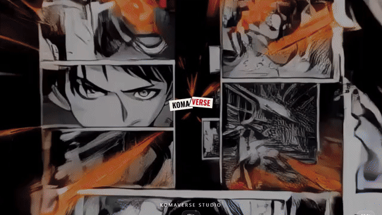
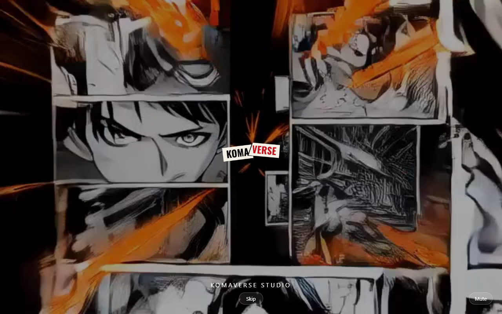
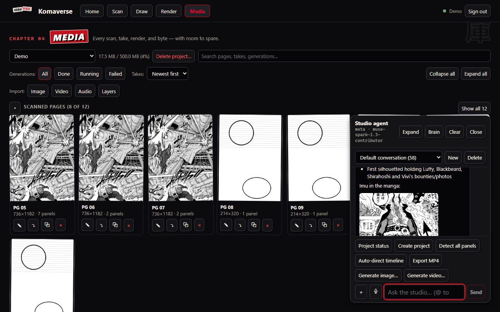
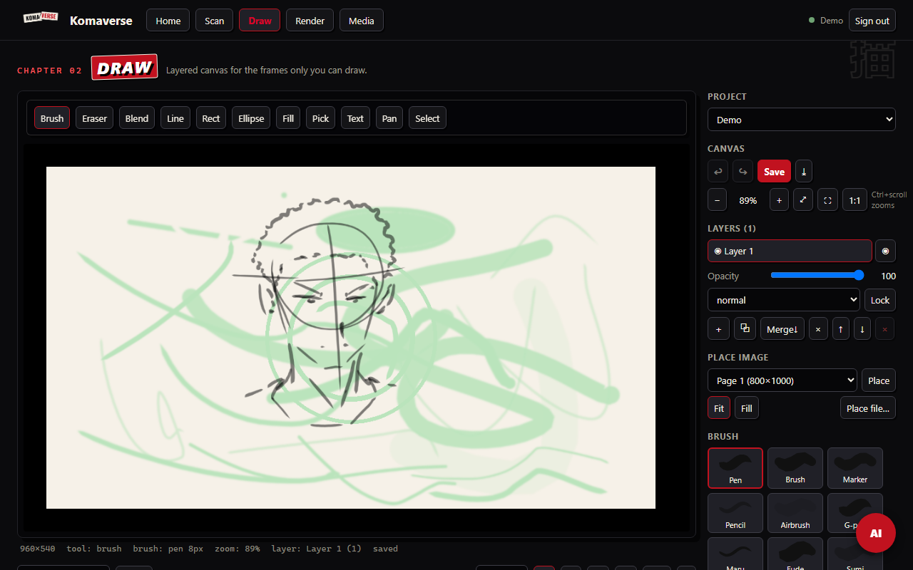
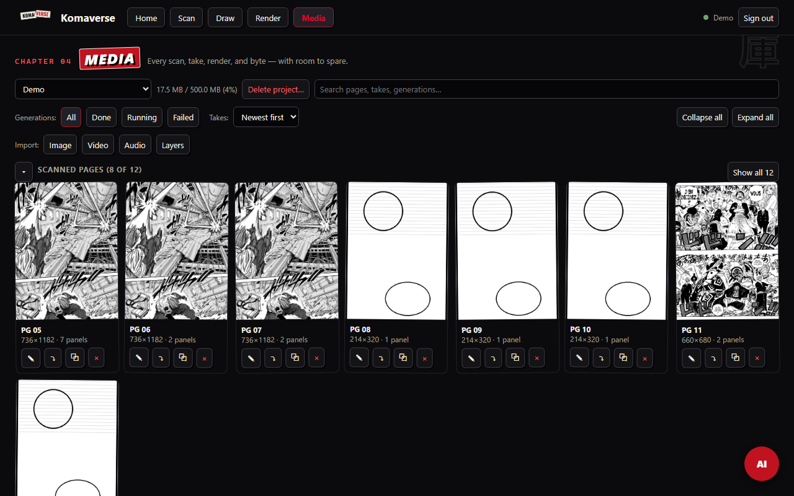
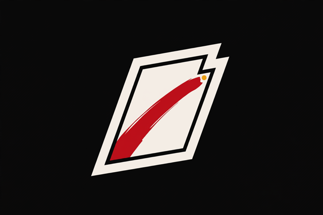
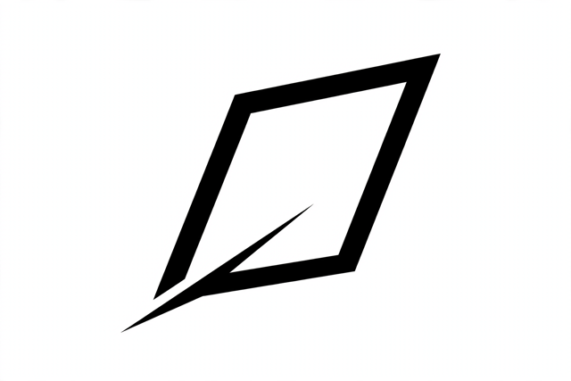

# Komaverse — turn manga pages into animated sequences

[](https://github.com/Davesoul/Komaverse/actions/workflows/ci.yml)

Browser anime studio: scan a page, detect its panels, clean up the frames,
generate the ones in between, animate and export — with no GPU on your machine.
Built for the Cerebral Valley × Meta hackathon on Meta Model API models
([Muse Spark](https://developers.meta.ai/docs/models) chat/vision, Muse Image,
Muse Voice, SAM 3.1) plus open-weight Muse models.



*Above: the real app — landing, home, scan, draw, render, media, and the AI
dock. Full clip: [demo.mp4](docs/assets/readme/demo.mp4) (13s, 720p).*

## See it

| | |
|---|---|
|  |  |
| Manga-hero landing with Netflix-style ident intro | Studio agent on `muse-spark-1.3-contributor`, threads, @-refs, inline art |
|  |  |
| Layered canvas, free pan, per-frame @-refs | Scanned pages, panel counts, takes, generations |

More: [home](docs/assets/readme/02-home.png) · [scan](docs/assets/readme/03-scan.png) ·
[render](docs/assets/readme/03-render.png)

## Made with Komaverse

Brand marks generated in-app through the AI widget (`create_image`,
provider-default image model, no prompt engineering beyond the subject):

| | |
|---|---|
|  |  |

## How it works

1. **Scan** — import `.kra`/`.ora`/GIF/APNG/PNG/JPG or draw; SAM + YOLO detect
   panels, SFX, cues, and page text (vision model reads what detectors can't).
2. **Draw** — layered canvas with onion-free pan/zoom, floatbar tools, and a
   per-frame ⧉ that copies the frame's `@frame:` reference for the chat.
3. **Render** — multi-lane timeline (video/audio/subs/overlay), head-trim from
   either end, per-clip speed/volume/fades, Ken Burns motion, native-audio MP4
   export that matches the preview frame-for-frame.
4. **Agent** — per-conversation memory with threads, `@`-mentions for every
   entity (`@frame:`, `@panel:`, `@media:`, `@gen:`, `@sequence:`), web research
   with inline pictures, voice (ElevenLabs + local XTTS cloning), and full
   studio control: generate, look, detect, timeline, export.
5. **Media** — every scan, take, generation, and export in one searchable
   library with per-project usage.

## Run it

```bash
# backend (FastAPI, :8001) — seeds demo@komaverse.local / demo1234
cd backend && uvicorn komaverse.main:app --port 8001
# studio (Vite, :5173)
cd apps/studio-web && npm install && npm run dev
```

Sign in with `demo@komaverse.local` / `demo1234` — judging uses this account,
no sign-up needed. Paste provider keys in the AI widget's **Brain** panel
(Meta, OpenRouter, Baseten, ElevenLabs) or via env; see
[backend/.env.example](backend/.env.example).

## AI models

| Family | Default | Options include |
|---|---|---|
| Chat brain | `muse-spark-1.3` (Meta) | Muse Spark contributor, Muse Wonder, Baseten open-weight |
| Vision | `muse-spark-1.3-contributor` (multimodal, auto when keyed) | any chat brain fallback |
| Image | provider default (cheapest) | Qwen, FLUX, Muse Image, Gemini banana |
| Video | `bytedance/seedance-2.0` | Seedance mini/fast, Wan 2.6/3.0-prime, Veo 3.1, Hailuo 3 Max, HeyGen 1 |
| Voice | ElevenLabs instant / local XTTS clone | Meta voice transcribe |

Video is silent by design (4s default, provider cheapest); voice, music, and SFX
are separate lanes you control.

## Docs

- [docs/DEMO_SCRIPT.md](docs/DEMO_SCRIPT.md) — 3-minute demo video script (chill YouTuber vibe approved)
- [docs/DECISIONS.md](docs/DECISIONS.md) — architecture decision records (ADR-1…ADR-60)
- [docs/SPEC.md](docs/SPEC.md), [docs/BRAND.md](docs/BRAND.md), [docs/COMPETITIVE.md](docs/COMPETITIVE.md), [docs/ROADMAP.md](docs/ROADMAP.md), [docs/OBSERVABILITY.md](docs/OBSERVABILITY.md)

## Capture pipeline (for contributors)

README visuals are real captures, reproducible with the repo's own tooling:

```bash
python -m pip install playwright && python -m playwright install chromium
python /tmp/capture.py   # docs/assets/readme/*.png via headless Chromium
python /tmp/reel.py       # demo.mp4 + demo.gif via imageio-ffmpeg
```

Technique follows the standard repo-to-video playbook (Playwright screencast /
record-demo style pipelines, AutoDemo/Repocast): drive the live app, screenshot
the tour, stitch with ffmpeg. No staged mockups — every pixel above is the app.
